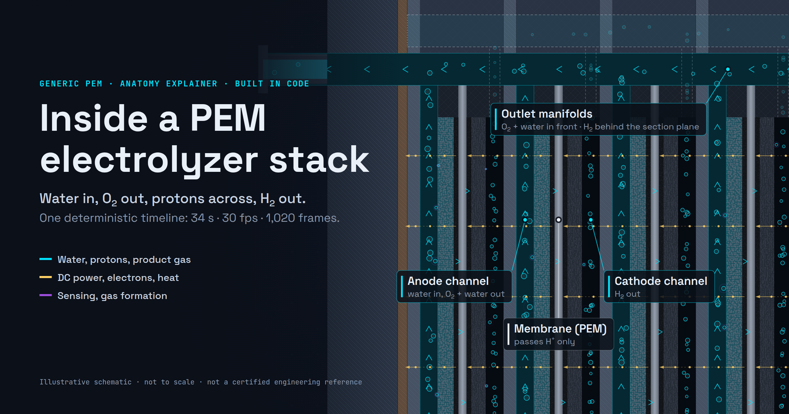

# PEM Electrolyzer Stack Explainer

A code-driven, anatomy-style motion explainer of a **generic proton exchange membrane (PEM) electrolyzer stack**. 34 seconds, 30 fps, 1,020 frames, rendered from a deterministic timeline in TypeScript and Canvas 2D. No video editor, no keyframed After Effects comp, no random numbers.

**Live:** https://mizcausevic-dev.github.io/pem-electrolyzer-stack-explainer/
**MP4 (1080p30, H.264):** [`public/media/pem-electrolyzer-stack-explainer-Cursor.mp4`](public/media/pem-electrolyzer-stack-explainer-Cursor.mp4)
**Medium article draft:** [`article/medium-article-Cursor.md`](article/medium-article-Cursor.md)



> Review status: consolidated working brief, not a certified engineering reference. Generic PEM architecture, no efficiency claims, no vendor specifications. Verify against the sources below before publication or reuse.

## What it shows

| Frames | Time | Chapter | What happens |
|---|---|---|---|
| 0–149 | 0:00–0:05 | Reveal MEA & plates | Exterior view, section A–A sweeps through the channels, dive to one repeating cell and its layers |
| 150–299 | 0:05–0:10 | Water feed | Deionized water fills the anode inlet manifold, rises in every anode channel in parallel, wets the porous transport layer |
| 300–509 | 0:10–0:17 | Gas evolution | DC power on; slow-motion schematic of the half-reactions at the catalyst interface; bubbles exit through the outlet manifolds |
| 510–749 | 0:17–0:25 | Cooling | Heat from cell losses, qualitative temperature rise along a channel, pull back to tank, pump, and heat exchanger |
| 750–1019 | 0:25–0:34 | Balance of plant | Power conversion, water treatment, gas separation and drying, sensors and controls; holds on the complete system |

Visual grammar: solid fills are hardware, translucent contours are fields, grid-paper panels are math. Cyan is the primary pathway (water, protons, product gas), gold is energy and actuation (DC power, electrons, heat, pumps), violet is sensing and state change. These are explanatory colors, not literal emission.

## Run it locally

Requires Node 22+.

```bash
npm install
npm run dev        # http://127.0.0.1:4317/
```

Keyboard: `Space` or `K` play/pause, `←`/`→` step one frame (`Shift` steps one second), `1`–`5` jump to a chapter, `Home`/`End` first and last frame, `F` fullscreen.

```bash
npm run build      # type-check + static build into dist/
npm run preview    # serve dist/ on http://127.0.0.1:4318/
```

## Render the video and images

Capture uses headless Chrome through `puppeteer-core` and `ffmpeg`. Each script starts its own Vite server unless you pass `--url`. Set `CHROME_PATH` if Chrome is not at `/usr/local/bin/google-chrome`.

```bash
npm run video                     # all 1,020 frames -> public/media/...-Cursor.mp4
npm run hero                      # 2400×1260 hero + 1200×630 social card
npm run frames -- --out review 0 425 1019   # individual PNGs for review
```

Measured on the build VM: the full video renders and encodes in about 97 s (22.96 MB, H.264 High, yuv420p, CRF 18, BT.709 tagged).

## How it is built

```
src/
  engine/    timeline (chapters, caption beats), camera keyframes, easing, seeded hash
  render/    stack section, cell layers, molecular schematic, heat field, balance-of-plant P&ID,
             world-anchored labels, HUD, math panels, hero composition
  site/      crawlable page copy and sources, injected into index.html at build time
  main.ts    player, scrubber, chapters, capture mode
scripts/     frame/video/hero capture, dist gate, live probe
```

- **Pure frame function.** `renderFrame(ctx, f, opts)` draws frame `f` from scratch. Two capture sessions rendering frames in opposite order produce byte-identical PNGs.
- **One world, one camera.** Every scene shares a single coordinate system. Zoom interpolates in log space around a fixed point, so macro-to-micro dives do not swing sideways. Detail fades in by zoom level (level of detail), so the molecular schematic only exists when the camera is close enough to read it.
- **Labels follow hardware.** 57 labels are anchored to world points (some to moving molecules) and drawn in screen space with leader lines. They fade out when they would collide with the header, legend, or locator inset.
- **Single source of truth for copy.** Chapter titles, caption beats, and sources live in TypeScript. A Vite plugin writes them into `index.html` as a transcript, chapter list, source list, and `VideoObject` JSON-LD with `Clip` parts, so crawlers and no-JS readers get the full explanation.

## Accuracy guardrails

- Mechanism (half-reactions, proton-only membrane, external electron circuit, DC energy input, typical 70–90 °C range) follows the U.S. DOE Hydrogen and Fuel Cell Technologies Office.
- Stack and balance-of-plant architecture follow two NREL manufacturing cost analyses.
- On-screen badges mark every departure from reality: not to scale, cell count reduced, schematic molecular scale, slow motion, time compression, simplified process schematic.
- No efficiency, cost, pressure, current density, or vendor-specific values appear anywhere.

## Sources

1. U.S. DOE HFTO, [Hydrogen Production: Electrolysis](https://www.energy.gov/eere/fuelcells/hydrogen-production-electrolysis)
2. U.S. DOE HFTO, [Hydrogen Production](https://www.energy.gov/eere/fuelcells/hydrogen-production)
3. NREL, [Manufacturing Cost Analysis for PEM Water Electrolyzers, NREL/TP-6A20-72740 (2019)](https://docs.nlr.gov/docs/fy19osti/72740.pdf)
4. NREL, [Updated Manufactured Cost Analysis for PEM Water Electrolyzers, NREL/TP-6A20-87625 (2024)](https://docs.nlr.gov/docs/fy24osti/87625.pdf)

## Deploy

Pushing to `main` runs `.github/workflows/deploy.yml`: `npm ci`, build, then `npm run verify:dist`, which fails the job if any file outside a web-servable extension allowlist (or any source, config, or tooling path) is in `dist/`, or if a build placeholder is unresolved. The job then publishes `dist/` as a snapshot of the `gh-pages` branch. Actions are pinned to commit SHAs.

After a deploy, check that the site resolves and that repository-only paths do not:

```bash
npm run probe:live
```

## Reuse in other verticals

The engine is not electrolyzer-specific. Swap `render/stack.ts`, `render/bop.ts`, and the copy in `engine/timeline.ts` to explain any layered hardware with a process around it: fuel cell stacks, battery cells and packs, heat pumps, water treatment trains, semiconductor process tools, or medical devices. The camera, label system, badges, capture pipeline, and crawlable page shell carry over unchanged.

## License

No license has been selected yet. Until a `LICENSE` file is added, default copyright applies to the code and the rendered media.
