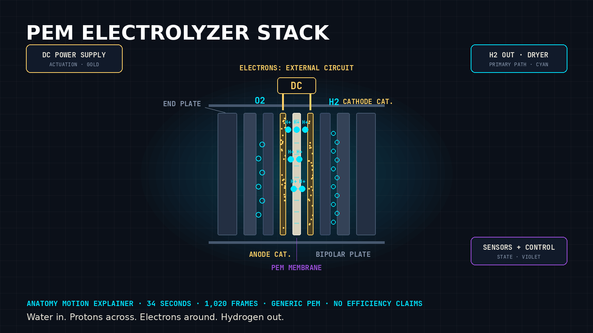

# PEM Electrolyzer Stack Explainer

**About:** Code-driven, anatomy-style motion explainer of a generic PEM electrolyzer stack. 34 seconds, 30 fps, 1,020 deterministic frames.

**Topics:** `pem-electrolyzer` `hydrogen` `fuel-cells` `electrolysis` `canvas-animation` `technical-explainer` `typescript` `vite` `science-communication` `kinetic-gain`

Live: https://mizcausevic-dev.github.io/pem-electrolyzer-stack-explainer/
Article: https://mizcausevic-dev.github.io/pem-electrolyzer-stack-explainer/article-Cursor.html (full text also in `medium-article-Cursor.md` for Medium cross-posting)



## What this is

One complete, usable slice: a scrub-able explainer that walks a generic PEM electrolyzer stack through five chapters on one causal chain.

| Frames | Time | Chapter | Camera |
|---|---|---|---|
| 0–149 | 0–5s | Reveal MEA and plates | Slow push-in to sectional close-up |
| 150–299 | 5–10s | Water feed | Lateral track along the inlet manifold |
| 300–509 | 10–17s | Gas evolution | Dive to the membrane interface |
| 510–749 | 17–25s | Cooling | Rise back to plate and coolant loop |
| 750–1019 | 25–34s | Balance of plant | Pull back, then settle on the full system |

Palette (explanatory, not literal emission): dark stage `#0B1019`, structures `#344257`, cyan `#00E5FF` for the primary pathway, gold `#FFD166` for actuation and energy, violet `#9D4EDD` for sensing and state.

## Why deterministic

`render(frame)` in `src/render.ts` is a pure function. Seeded hashes replace `Math.random()`. Any frame renders identically on any machine, can be cited by number, deep-linked with `?frame=812`, stepped with arrow keys, and exported as PNG from the player.

## Run locally

```bash
npm install
npm run dev      # http://127.0.0.1:4319
npm run build    # typecheck + production build to dist/
npm run preview
```

## Accuracy scope

Generic PEM architecture only. Half-reactions: anode `2H2O → O2 + 4H+ + 4e−`, cathode `4H+ + 4e− → 2H2`. Bubble counts follow the 2:1 H2:O2 mole ratio. Scale changes, slow motion, and time compression are labeled on screen. No efficiency claims, no invented specifications, no measured data presented as measured. Where a mechanism cannot be shown faithfully (proton transport), the animation uses an explicitly labeled schematic.

Process reference: U.S. DOE, Hydrogen Production / Electrolysis, https://www.energy.gov/eere/fuelcells/hydrogen-production

Working explainer, not a certified engineering reference. Verify subject-specific details before publication.

## Repurposing

The timeline engine (`src/timeline.ts`: chapters, eased camera keys, causal ribbon) is subject-agnostic. Swap the chapter data and stack geometry and the same code explains a fuel cell in reverse, a flow battery, or any layered electrochemical device. The color legend keeps its meaning across subjects.

## Files

- `src/timeline.ts` — frame math, chapters, camera keys, deterministic hash
- `src/render.ts` — pure canvas renderer
- `src/main.ts` — playback, scrubbing, chapter UI, PNG export
- `public/hero-Cursor.png` — hero image, drawn by `tools/make-hero.py`
- `medium-article-Cursor.md` — full Medium article (source for `public/article-Cursor.html`, built by `tools/make-article.py`)

## Deploy

GitHub Pages serves the `gh-pages` branch. Rebuild and republish:

```bash
npm run build
git -C . worktree add /tmp/gh-pages gh-pages   # first time: orphan branch with dist contents
cp -r dist/. /tmp/gh-pages/ && cd /tmp/gh-pages && git add -A && git commit -m "Deploy" && git push
```
